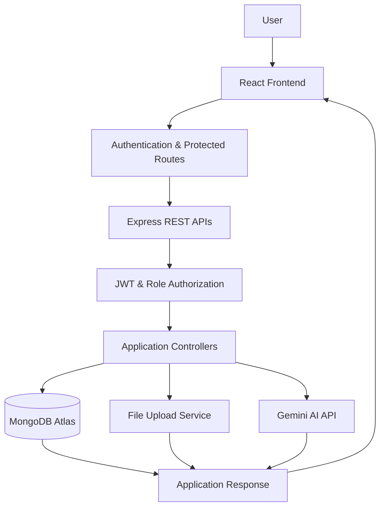
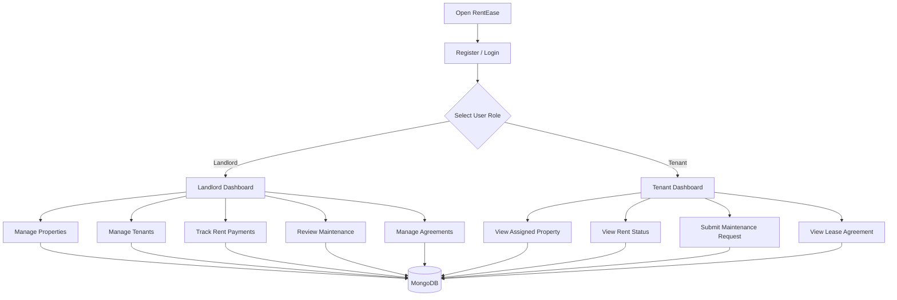
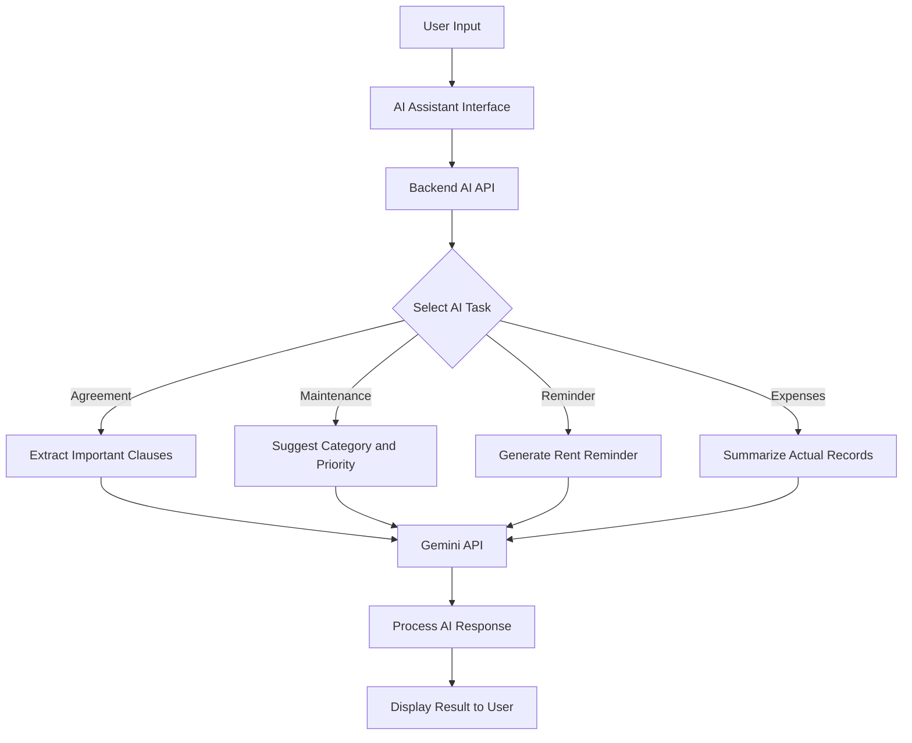

# 🏠 RentEase – AI Rental Property Management Platform

**Simplifying Property Management, Rent Tracking, and Tenant Communication with AI**

<p align="center">
  
</p>

<p align="center">
  <a href="https://rentease-2025.ai.studio">Live Demo</a> •
  <a href="#features">Features</a> •
  <a href="#technology-stack">Tech Stack</a> •
  <a href="#installation-and-setup">Installation</a>
</p>

---

## 🌐 Live Demo

**[Visit RentEase – AI Rental Property Management](https://rentease-2025.ai.studio)**

## 📌 Overview

RentEase is an AI-powered rental property management platform designed to simplify the way landlords manage properties and tenants handle their rental responsibilities.

Managing rental properties often involves multiple spreadsheets, manual rent tracking, scattered maintenance requests, and difficult document management.

RentEase brings these essential operations together in one centralized platform.

It provides separate dashboards for landlords and tenants, property management tools, rent tracking, maintenance request management, lease document storage, and AI-powered assistance.

The platform aims to make rental management more organized, transparent, and efficient.

## 🎯 Problem Statement

Traditional rental property management involves several challenges:

- Difficulty managing multiple rental properties.
- Manual tracking of monthly rent payments.
- Poor communication between landlords and tenants.
- Difficulty tracking maintenance complaints.
- Important lease documents getting misplaced.
- Time-consuming rental agreement review.
- Forgetting rent due dates and lease expiration dates.

## 💡 Our Solution

RentEase provides a centralized rental management system where landlords and tenants can manage their rental activities through dedicated dashboards.

With AI assistance, the platform can help extract important rental agreement information, categorize maintenance complaints, generate rent reminder messages, and summarize property expenses using available records.

---

## ✨ Features

### 👨‍💼 1. Landlord Dashboard

A centralized dashboard that helps landlords monitor their rental business.

- Overview of total properties.
- Total registered tenants.
- Monthly rent collection.
- Pending rent payments.
- Recent payment activities.
- Recent maintenance requests.
- Monthly rent collection analytics.

### 🏡 2. Property Management

Manage multiple rental properties from one place.

- Add new properties.
- Edit property information.
- Delete properties.
- View property details.
- Upload property images.
- Manage property availability.
- Store address, rent, bedrooms, bathrooms, and property type.

### 👥 3. Tenant Management

Manage tenant information and property assignments.

- Add new tenants.
- Update tenant details.
- Assign tenants to properties.
- View tenant profiles.
- Store contact information.
- Track lease duration.
- Manage security deposits.

### 💰 4. Rent Management

A simple rent tracking system for landlords and tenants.

- Record monthly rent payments.
- Track paid and pending payments.
- Identify overdue rent.
- View payment history.
- Filter payments by month and status.
- Update payment records.
- View monthly rent collection.

**Note:** RentEase focuses on payment record management. It does not require a real payment gateway for recording payments.

### 🔧 5. Maintenance Management

A structured system for reporting and managing property maintenance issues.

Tenants can:
- Submit maintenance requests.
- Describe the problem.
- Select an issue category.
- Upload supporting images.
- Track request status.

Landlords can:
- View maintenance requests.
- Review issue descriptions.
- Update request status.
- Respond to tenant complaints.
- Track maintenance history.

Maintenance categories:
- Plumbing
- Electrical
- Cleaning
- Furniture
- Appliances
- Other

Request statuses:
- Submitted
- In Progress
- Resolved

### 📄 6. Lease Agreement Management

Keep rental agreements organized in one place.

- Upload rental agreement documents.
- Associate agreements with tenants.
- View agreement details.
- Track lease start and end dates.
- Download stored documents.
- Identify active and expired agreements.

### 🤖 7. AI Rental Assistant

RentEase includes an AI assistant to simplify common rental management tasks.

**A. Rental Agreement Analyzer**
- Extract monthly rent.
- Identify security deposits.
- Extract lease start and end dates.
- Identify notice periods.
- Summarize maintenance responsibilities.
- Highlight important agreement information.

**B. Maintenance Categorization**
- Analyze maintenance descriptions.
- Suggest appropriate issue categories.
- Recommend Low, Medium, or High priority.

**C. Rent Reminder Generator**
- Generate polite rent reminder messages.
- Include tenant name.
- Include rent amount.
- Include payment due date.
- Allow landlords to copy generated messages.

**D. Monthly Expense Summary**
- Summarize rent collected.
- Identify pending rent.
- Review recorded maintenance expenses.
- Generate understandable monthly summaries from available application data.

AI-generated information should be treated as assistance, not legal or financial advice. Financial figures must come from actual application records.

### 🔐 8. Authentication and Role-Based Access

- User registration and login.
- Password hashing.
- JWT-based authentication.
- Protected application routes.
- Landlord and tenant roles.
- Role-based dashboard access.
- Restricted access to private property and tenant information.

### 📱 9. Responsive User Interface

- Modern SaaS-style interface.
- Responsive dashboard layouts.
- Sidebar navigation.
- Clean property cards.
- Payment status indicators.
- Interactive charts.
- Mobile-friendly design.

---

## 🛠️ Technology Stack

| Technology | Purpose |
|---|---|
| React.js | Frontend development |
| Vite | Frontend build tooling |
| JavaScript | Application logic |
| Tailwind CSS | Styling and responsive UI |
| React Router | Frontend navigation |
| Axios | API communication |
| Node.js | Backend runtime |
| Express.js | REST API development |
| MongoDB Atlas | Database |
| Mongoose | MongoDB object modeling |
| JWT | Authentication |
| bcrypt | Password hashing |
| Multer | File uploads |
| Gemini API | AI assistance |
| Recharts | Dashboard analytics |
| Lucide React | Icons |

---

## 🏗️ System Architecture

RentEase follows a simple client-server architecture.



## 🔄 Application Workflow



## 🤖 AI Assistant Workflow



---

## 🗄️ Database Design

RentEase uses MongoDB Atlas to store application data.

The main collections include:

### 1. Users
Stores landlord and tenant account information.

- name
- email
- password
- phone
- role
- createdAt

### 2. Properties
Stores rental property details.

- landlordId
- propertyName
- propertyType
- address
- city
- monthlyRent
- bedrooms
- bathrooms
- description
- image
- availabilityStatus

### 3. Tenants
Stores tenant and property assignment information.

- landlordId
- userId
- propertyId
- name
- email
- phone
- monthlyRent
- securityDeposit
- leaseStartDate
- leaseEndDate

### 4. Payments
Stores rent payment records.

- landlordId
- tenantId
- propertyId
- amount
- paymentDate
- paymentMethod
- status
- month

### 5. MaintenanceRequests
Stores maintenance complaints.

- tenantId
- propertyId
- title
- category
- description
- image
- priority
- status
- landlordResponse
- createdAt

### 6. LeaseAgreements
Stores lease document information.

- landlordId
- tenantId
- propertyId
- fileName
- fileUrl
- startDate
- endDate
- status
- uploadedAt

---

## 🔌 REST API Overview

The backend uses RESTful APIs to connect the React frontend with the MongoDB database.

| Module | Method | Endpoint |
|---|---|---|
| Authentication | POST | `/api/auth/register` |
| Authentication | POST | `/api/auth/login` |
| Authentication | GET | `/api/auth/me` |
| Properties | GET | `/api/properties` |
| Properties | POST | `/api/properties` |
| Properties | PUT | `/api/properties/:id` |
| Properties | DELETE | `/api/properties/:id` |
| Tenants | GET | `/api/tenants` |
| Tenants | POST | `/api/tenants` |
| Payments | GET | `/api/payments` |
| Payments | POST | `/api/payments` |
| Maintenance | GET | `/api/maintenance` |
| Maintenance | POST | `/api/maintenance` |
| Agreements | GET | `/api/agreements` |
| Agreements | POST | `/api/agreements` |
| Dashboard | GET | `/api/dashboard/landlord` |
| Dashboard | GET | `/api/dashboard/tenant` |
| AI Assistant | POST | `/api/ai/analyze-agreement` |
| AI Assistant | POST | `/api/ai/categorize-maintenance` |
| AI Assistant | POST | `/api/ai/generate-reminder` |
| AI Assistant | POST | `/api/ai/expense-summary` |

*API routes represent the planned application interface; retain only endpoints implemented in the actual backend.*

---

## 📸 Screenshots

Add actual screenshots of your application in the `docs/screenshots/` directory.

### 1. Landing Page


### 2. Landlord Dashboard


### 3. Tenant Dashboard


### 4. Property Management


### 5. Rent Management


### 6. Maintenance Requests


### 7. AI Rental Assistant


### 8. Lease Agreement Management


---

## ⚙️ Installation and Setup

Follow these steps to run RentEase locally.

### Prerequisites

Install the following:

- Node.js
- npm
- MongoDB Atlas account
- Git
- Gemini API key (optional, for AI functionality)

### 1. Clone the Repository

```bash
git clone https://github.com/YOUR_USERNAME/rentease-ai-rental-management.git
cd rentease-ai-rental-management
```

### 2. Install Backend Dependencies

```bash
cd server
npm install
```

### 3. Install Frontend Dependencies

```bash
cd ../client
npm install
```

### 4. Configure Environment Variables

Create a `.env` file inside the server directory.

```env
PORT=5000
MONGODB_URI=your_mongodb_connection_string
JWT_SECRET=your_secure_random_secret
GEMINI_API_KEY=your_gemini_api_key
CLIENT_URL=http://localhost:5173
```

Create a `.env` file inside the client directory.

```env
VITE_API_URL=http://localhost:5000/api
```

Never upload real environment variables or secret keys to GitHub.

### 5. Start the Backend

```bash
cd server
npm run dev
```

### 6. Start the Frontend

Open another terminal:

```bash
cd client
npm run dev
```

Open the local URL displayed by Vite, usually:

```text
http://localhost:5173
```

---

## 🔒 Security Practices

- Passwords are hashed using bcrypt.
- JWT authentication protects private routes.
- Role-based authorization separates landlord and tenant access.
- API requests are validated.
- Sensitive configuration is stored in environment variables.
- Users should only access records they are authorized to view.
- Uploaded documents should be restricted to authorized users.

---

## 🚀 Future Improvements

Potential improvements for future versions:

- Online rent payment gateway integration.
- Automated email and SMS notifications.
- Lease expiration reminders.
- Property availability calendar.
- Advanced maintenance analytics.
- Tenant feedback and ratings.
- Downloadable rent receipts.
- Improved AI agreement analysis.
- Cloud-based document storage.

---

## 🎯 Project Objectives

RentEase demonstrates practical full-stack development concepts:

- Building a React-based frontend.
- Developing REST APIs with Node.js and Express.
- Designing MongoDB database schemas.
- Implementing JWT authentication.
- Applying role-based access control.
- Managing file uploads.
- Integrating an external AI API.
- Creating dashboard analytics.
- Connecting frontend and backend services.

---

## 👨‍💻 Author

**Ujjwal Awasthi**

- GitHub: [@ujjwalawasthi7597-del](https://github.com/ujjwalawasthi7597-del)
- LinkedIn: [Ujjwal Awasthi](https://www.linkedin.com/in/ujjwal-awasthi-90942237b)
- LeetCode: [Ujjwal9795](https://leetcode.com/u/Ujjwal9795/)
- GeeksforGeeks: [Profile](https://www.geeksforgeeks.org/profile/ujjwalawavs96)

---

## 📄 License

This project is intended for educational and portfolio purposes. Add a license file if you plan to distribute or reuse the source code.

---

<p align="center">
  <b>RentEase – Making Rental Property Management Smarter and Simpler.</b>
</p>
